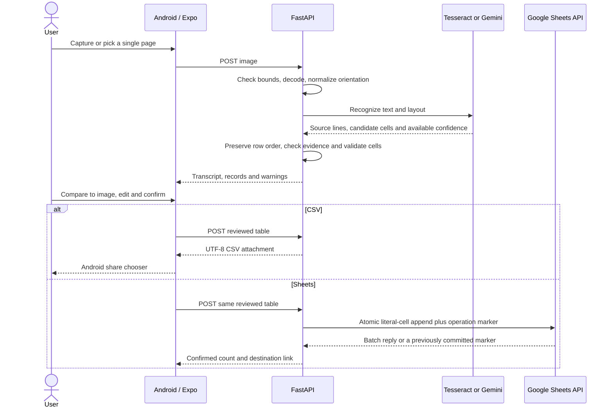

# Architecture and API



## Processing

- `app/images.py` checks encoded bytes, MIME and format, decoded dimensions, animation and visible contrast. It applies EXIF orientation and conservative resampling. Dark and low-detail indicators are image heuristics.
- `app/ocr/` keeps the provider contract separate from the exported table. The local adapter reads Tesseract word boxes and minimum word confidence per cell. It compensates for mild tilt using word positions, groups nearby vertical centers, splits large horizontal gaps and assigns segments to column anchors. When column positions are ambiguous it preserves the source line with a warning. The Gemini adapter asks for literal ordered source lines, row roles and candidate cells in JSON. It gives the model no tools and treats document text as data. Its confidence values are unknown.
- `app/extraction.py` builds a rectangular table, generates fallback headings, checks each candidate against text in the same line, keeps missing cells explicit, and flags unmatched source content. The check catches some inconsistencies between candidate cells and transcript. Both can still share the same recognition error. No provider can recover text outside the photo or reliably identify rows it never detected.
- `app/validation.py` flags missing values, low scores, date ambiguity, explicit numeric/time formats and potential duplicates. It applies checks to recognized labels and leaves values intact.
- `mobile/App.tsx` keeps the original image, raw transcript, draft values and confirmed values separate. Editing resets the confirmation. The row editor keeps document column order and applies per-field bidi alignment to Hebrew and mixed strings.

### Where the main logic lives

- `mobile/App.tsx` coordinates navigation and the current document. `src/Review.tsx` edits extracted or manual rows. `src/CsvPreview.tsx` displays CSV options; `src/csv.ts` handles files and sharing.
- `backend/app/main.py` connects HTTP routes to the underlying operations. `app/ocr/` reads the image, `app/extraction.py` checks and shapes the rows, and `app/csv_export.py` writes the CSV.
- `app/sheets_documents.py` finds the data tab for a document or set of headings. `app/sheets_export.py` handles reads and writes within a tab. Hebrew and English headings can coexist because every document returns its own columns. Both editors call the same update endpoint.

## HTTP contract

FastAPI serves interactive docs at `http://127.0.0.1:8000/docs`. Application errors include a stable `code` and user-facing `message`. HTTP 422 request errors can include an `issues` array. Uploads are limited to 12 MiB, at least 120 px on each side and at most 32 megapixels. The normalized JPEG is at most 2,600 px on its longest side. Export JSON is capped at 4 MiB, with up to 300 nonblank rows and 32 columns.

| Method and path | Request | Successful result |
| --- | --- | --- |
| `GET /health` | None | Status, selected OCR provider and configuration flags |
| `POST /api/documents/process` | Multipart `image`, JPEG, PNG or WebP. Use `mode=handwriting` for Gemini or `mode=local` for Tesseract. Omitting the mode uses the configured default. | `document_id`, `provider`, `raw_text`, `headings`, ordered `records`, page direction, warnings, `review_required` and `duration_ms` |
| `POST /api/exports/csv` | Reviewed-table JSON | `text/csv` attachment with UTC filename and UTF-8 BOM |
| `POST /api/exports/sheets` | Same reviewed-table JSON | `confirmed`, spreadsheet ID and URL, confirmed row count and replay flag |

Each extracted record contains a `cells` array of strings or nulls, `source_text`, parallel `confidence` values and `warnings`. A warning may identify a zero-based column index. Both exports require explicit strings for approved cells, including empty strings for approved blanks. The following payload shows two reviewed records.

```json
{
  "document_id": "4e0b25a0-6d4e-4fc0-8c52-97d97a8237c6",
  "headings": ["Vehicle", "Driver", "Destination"],
  "rows": [["102", "דניאל", "חיפה"], ["205", "Maya", "Tel Aviv"]]
}
```

CSV uses Python's standard writer to escape quotes, separators and newlines. Formula-like strings receive a protective apostrophe. Sheets uses explicit `userEnteredValue.stringValue` fields, which provides the literal semantics of RAW input within the atomic batch. Spreadsheet applications may still infer date and number types when opening a CSV, so use text-column import for values with meaningful leading zeroes. [Sheets value input options](https://developers.google.com/workspace/sheets/api/guides/values).

## Sheets confirmation and retries

The server checks the tab's heading row, then uses `spreadsheets.batchUpdate` to append after existing data. When the tab is empty, the first batch includes headers and a unique schema marker to prevent two simultaneous first writes. Each batch also creates a unique document marker in the same transaction. The marker stores a document UUID and a hash of the exact reviewed table. Google rejects duplicate metadata IDs atomically. A failed or missing reply triggers a marker read. A matching marker confirms the earlier write and a different payload for the same document returns a conflict. The app stores a pending reviewed payload on-device before making the request and reuses it after connection loss or app restart.

The append response omits the updated A1 range. The API returns `updated_range: null` and links to the tab. The design assumes a dedicated tab and retained markers. Rescanning the same paper creates a fresh document ID. A metadata ID collision fails safely. [Atomic batch behavior](https://developers.google.com/workspace/sheets/api/reference/rest/v4/spreadsheets/batchUpdate), [developer metadata IDs](https://developers.google.com/workspace/sheets/api/reference/rest/v4/spreadsheets.developerMetadata), [AppendCells](https://developers.google.com/workspace/sheets/api/reference/rest/v4/spreadsheets/request#AppendCellsRequest).
